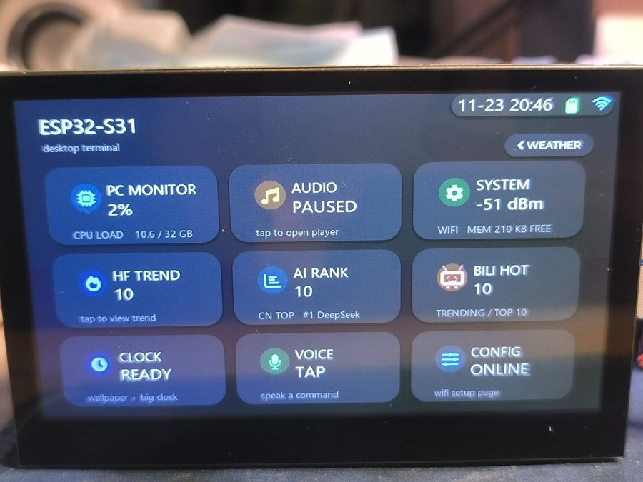
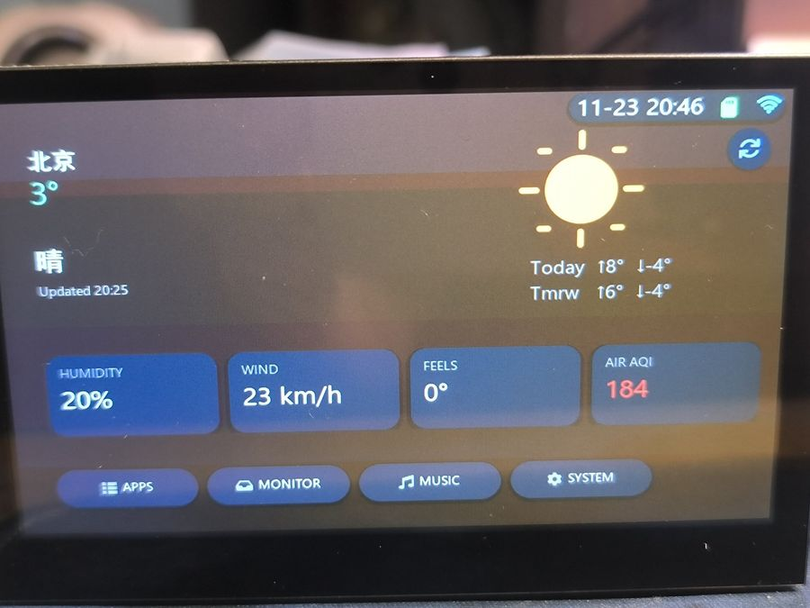
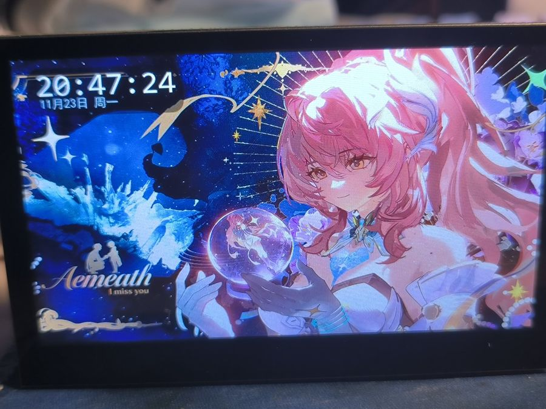
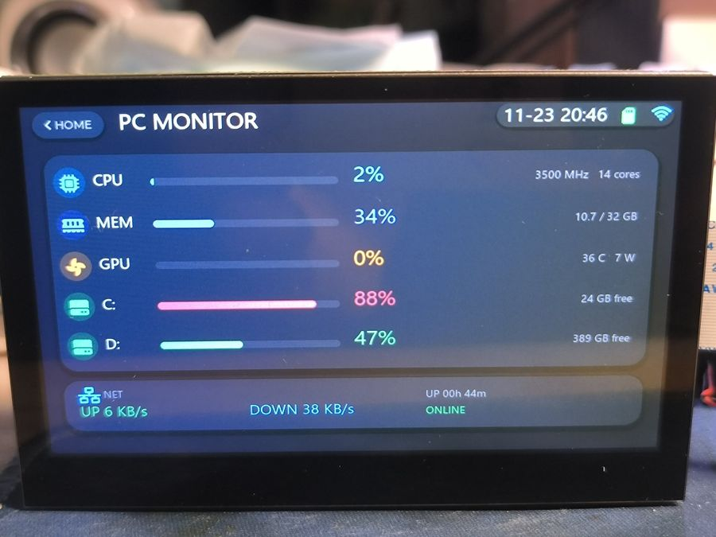
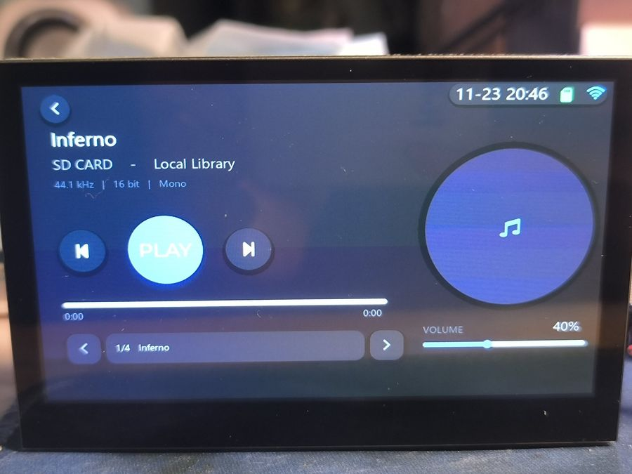
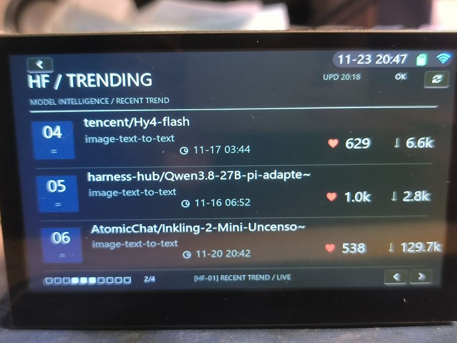
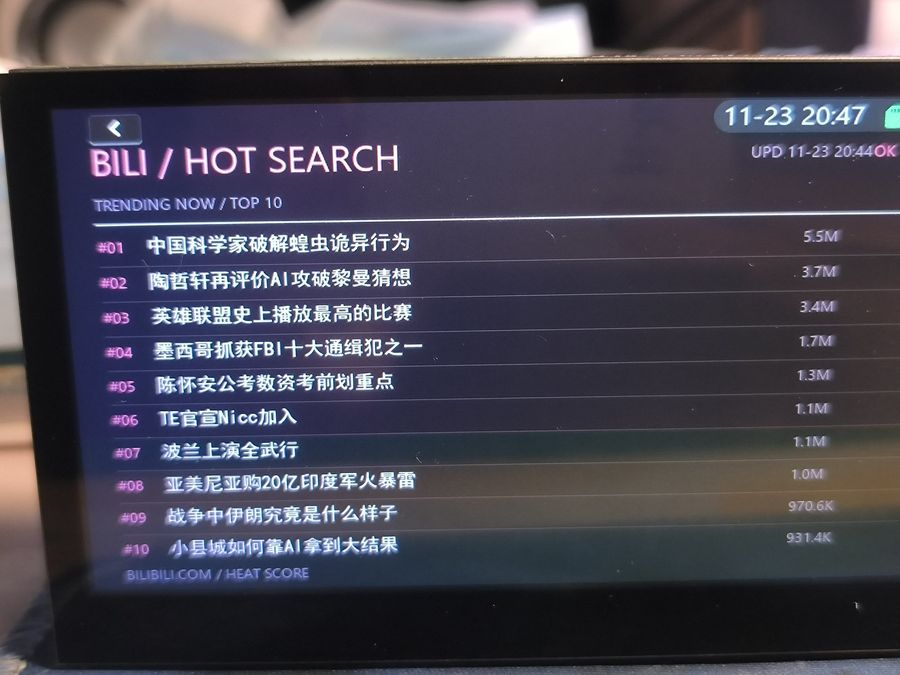
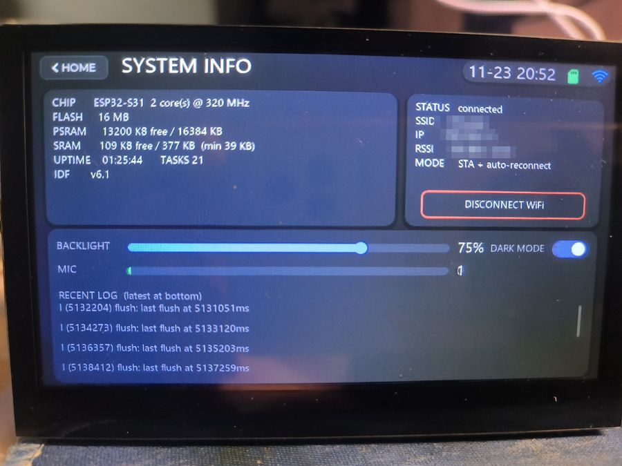
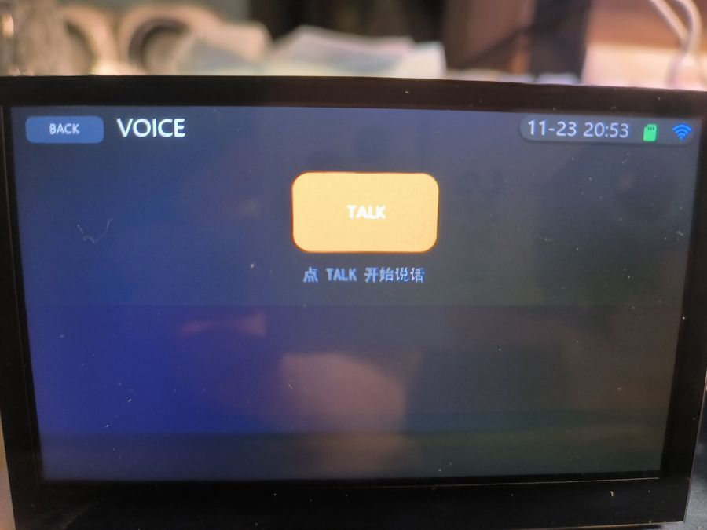

# ESP32-S31 桌面信息面板

基于 **ESP32-S31**（RISC-V 双核 320 MHz + Wi-Fi 6）的 4.3 寸桌面信息终端。
LVGL 9.6 驱动 **800×480 RGB 屏**（66 fps），集成天气、榜单、音乐播放、语音助手与时钟壁纸。

<p align="center">
  
</p>

> ⚠️ ESP32-S31 的官方规格书目前是 **预发布 v0.5（PRELIMINARY）**，生态资料极少。
> 本仓库里的时序参数、音频配置、性能数据都是在这块板子上**实测**得出的，
> 对后续使用这颗芯片的人应该能省不少时间。

---

## 硬件

| 项 | 配置 |
|---|---|
| 开发板 | 慧勤智远 **ESP32-S31 CB V1.1**（与乐鑫 Korvo-1 同构） |
| 芯片 | **ESP32-S31**：RISC-V 双核 320 MHz（HP）+ 单核 40 MHz（LP），512 KB SRAM |
| 内存 | 合封 **16 MB PSRAM**（250 MHz，8-bit DDR）+ 16 MB Flash |
| 无线 | **Wi-Fi 6**（2.4 G，1T1R）+ **BT 5.4**（LE Audio / 经典蓝牙）+ Zigbee 3.0 + Thread 1.4 |
| 显示屏 | 4.3" **800×480** RGB（WKS43WV067，HX8264/HX8664 时序，**无 GRAM**） |
| 触摸 | **GT1151Q**（I2C0，配置表起始 0x8050） |
| 音频 | **ES8389** codec（2×ADC + 2×DAC）+ **NS4150B ×2** D 类功放 |
| 麦克风 | 2× 模拟 MEMS（MIC1 接 codec 的 MIC2 通道，左右有交叉） |
| 存储 | TF 卡座 **SDMMC 4-bit** + Flash 内 10 MB FAT 分区（`/music`） |
| 板载灯 | WS2812 ×4（IO37） |
| 电源 | 双 Type-C VBUS 并联 → 1.5 A 自恢复保险 → SY8089A 降压 3.3 V |

**三个 Type-C 口分工不同，插错会白忙**：

| 丝印 | 用途 |
|---|---|
| **COM** | CH343P → UART0，**烧录 + 看日志**（带 DTR/RTS 自动下载） |
| **USB** | 原生 USB 2.0 HS，OTG **Host**（读 U 盘/键鼠），**不能用来烧录** |
| **PWR** | **纯供电**，D± 标 NC，不传数据 |

---

## 已实现功能

| 场景 | 内容 |
|---|---|
| **WEATHER** | 多源天气（含缓存，断网也有画面）、逐时/多日曲线 |
| **PC MONITOR** | 拉取 PC 端 CPU/内存/网络状态（`tools/pc_monitor_server.py`） |
| **AUDIO** | 播放 TF 卡与 Flash FAT 分区的 WAV，进度/音量/诊断模式 |
| **HF TREND** | HuggingFace 趋势榜 |
| **AI RANK** | AI 模型排行榜（多榜切换） |
| **BILI HOT** | B 站热榜 |
| **CLOCK** | 时钟壁纸：随机壁纸 + **硬件 JPEG 解码** + 96 px 等宽数字 + 遮罩防烧屏 |
| **VOICE** | **语音对话**：KEY0 / 触屏触发 → 能量 VAD 断句 → PC 侧 ASR（SenseVoice）→ 云端大模型生成回复 → GPT-SoVITS 合成**爱弥斯音色** → 设备播放，配四色状态灯（详见[语音对话](#语音对话voice)） |
| **SYSTEM** | 背光、麦克风电平、运行日志、WiFi 配网入口 |
| **APPS** | 九宫格应用页 |

配套：

- **配网**：首次上电开 SoftAP（`SmartPanel-XXXX`），浏览器访问 `192.168.4.1` 填 WiFi / PC 地址 / 语音服务参数，全部存 NVS
- **PC 模拟器** `pc_sim/`：把 LVGL UI 编到 Windows 上跑，改界面不用每次烧板
- **LED 服务** `led_service`：底色 + 闪烁 + 呼吸 + 彩虹渐变，效果结束自动回底色，任何上层可调

---

## 界面一览

<table>
  <tr>
    <td align="center" width="50%"><br><sub>天气 · 多源 + 本地缓存</sub></td>
    <td align="center" width="50%"><br><sub>时钟壁纸 · JPEG 硬件解码</sub></td>
  </tr>
  <tr>
    <td align="center"><br><sub>PC 主机监控 · CPU/内存/GPU/磁盘/网络</sub></td>
    <td align="center"><br><sub>音乐播放 · TF 卡 / Flash 分区</sub></td>
  </tr>
  <tr>
    <td align="center"><br><sub>HuggingFace 趋势榜</sub></td>
    <td align="center"><br><sub>B 站热榜</sub></td>
  </tr>
  <tr>
    <td align="center"><br><sub>系统信息 · 芯片 / 内存 / 网络 / 背光</sub></td>
    <td align="center"><br><sub>语音助手 · 能量 VAD + ASR</sub></td>
  </tr>
</table>

> 图中壁纸均为**使用者自行上传**的内容：本仓库与固件都不包含任何壁纸素材，设备也不内置图库。
> 系统页截图里的 SSID / IP 已打码。

---

## 语音对话（VOICE）

**说一句话 → 她听懂 → 她用爱弥斯的声音回答**，全链路：

```
按 KEY0 / 点屏上 TALK
   │
   ├─ 设备：I2S 录音 16 kHz，能量 VAD 断句（静音 800 ms 结束，最长 10 s）
   │
   ├─ → POST /api/asr      设备把 WAV 上传，PC 侧 SenseVoice-Small 识别（本地 CPU，约 0.3 s）
   │
   ├─ → POST /api/reply    一次调用完成"对话 + 合成"：
   │       ├─ 人设 RAG：597 条设定向量检索 + 常驻的关系/场景说明
   │       ├─ DeepSeek（云端，约 0.9 s）生成回复文本 + 情绪标签
   │       └─ GPT-SoVITS（本地 GPU，约 3 s）按情绪选参考音频合成爱弥斯音色
   │
   └─ WAV 边收边写 SD 卡 → 播放（44.1 kHz 单声道）
```

端到端约 **6~10 秒**（TTS 合成是主要耗时），识别、对话、合成都发生在 PC 侧，设备只负责录音、上传、播放。

### 状态灯（板载 WS2812，IO37）

四色语义，"现在什么状态"用余光就能看出来，不需要记：

| 时刻 | 灯 |
|---|---|
| 待机 | **灭** |
| 聆听中 | 蓝色呼吸（1.2 s） |
| 等回复 | 黄色快闪（0.5 s） |
| 她说话 | 绿色呼吸（0.9 s） |
| 出错 | 红色闪 3 下 → 回灭 |

### 物理按键 KEY0（IO61）

**注意**：KEY0 接的是原理图上的 `BOOT` 网络，即 **IO61**（ESP32-S31 的 strapping 脚，**不是** ESP32-S3 的 IO0）。因此它与 I2C0（IO0/IO1，触摸 + codec 共用）**不冲突**。

| 动作 | 效果 |
|---|---|
| 空闲时按一下 | 开始听（等价于屏上 TALK；说完 VAD 自动结束，**不用再按**） |
| 她说话时按一下 | **立刻打断** |
| 开机瞬间按住 | 会进 ROM 下载模式（strapping 特性，正常运行时无影响） |

### 配置

| 文件 | 说明 |
|---|---|
| `tools/persona.txt` | 核心人设（290 字：性格、说话方式、输出格式），**进仓库** |
| `tools/persona/*.md` | 4.1 万字详细设定（背景/关系/语料），**不进仓库**（个人内容） |
| `tools/llm.json` | 大模型地址 / 模型名 / API key，**不进仓库**。复制 `llm.example.json` 后填自己的值 |
| `tools/检查key.py` | 填完 key 跑一遍自检：可用 / 401 / 404 / 429 会给不同提示 |

启动 / 重启见下方 **PC 侧辅助服务**。

---

## 三个值得单独说的技术点

### 1. 屏幕时序：三条互相冲突的硬约束，只有一个解

```
PCLK 40 MHz · H_total 1120 × V_total 541 · 66.02 fps · pclk_active_neg = true
porch: HSW 48 / HBP 160 / HFP 112 · VSW 3 / VBP 32 / VFP 26
```

| 改动 | 症状 | 原因 |
|---|---|---|
| PCLK 降到 25 MHz | 矩形边缘 flicker | 48.5 Hz < 临界闪烁频率（CFF 随亮度上升） |
| PCLK 用 32 MHz | 文字波浪 | `160/64 = 2.5` 小数分频，周期在 25/37.5 ns 间交替 |
| `pclk_active_neg = false` | 右侧 1~2 px 白竖线 | 行尾采样点落在建立窗口外 |
| 40 MHz + 小 porch | render 24 ms → 49 ms | DMA 占 74.5%，CPU 访问 PSRAM 被仲裁阻塞 |

**零抖动的硬约束**：`160 MHz ÷ (2 × PCLK)` 必须整除（IDF 固定 `mo=2`）
⇒ 只有 **40 / 26.67 / 20 MHz** 可用，其中只有 40 MHz 能跑到 66 Hz。

### 2. 音频：双声道不干净，通道还交叉

I2S RX 是**双声道交错**，右声道带约 1100 的固定直流偏置（单端输入），
且 MIC1 走的是 codec 的 MIC2 通道，左右不确定。

处理方式：两路各自去直流 + **首次有信号时判定一次并整段锁定**。
绝不能每块重判——两路能量接近时通道会逐块跳变，音频被切成两段不同信号，
ASR 会直接听不懂（实测把"测试一下"识别成"来证据一下"）。

### 3. LVGL 性能：两个反直觉的开销

- **`shadow_width` 是 CPU 逐像素模糊**。9 张卡片设 22 px 阴影时，应用页掉到 37 FPS / render 73 ms；
  改成 6 px 后回到 44 FPS / render 24 ms。卡片多或需要周期刷新时，阴影别超过 8 px。
- **场景表里的 `hold_ms` 就是帧间隔**。曾给榜单页设 50 ms"省 CPU"，结果等于锁死 20 FPS，
  静态看不出、一滑动就发涩。有滚动/动画的页面一律 ≤ 20 ms；省 CPU 该靠"不重绘"而不是"降帧"。

---

## 目录结构

```
components/
  BSP/        板级驱动：LCD / TOUCH / AUDIO / STORAGE / I2C / LED
  ui/         LVGL 界面：10 个场景 + 主题 + 字体
  netapp/     网络：WiFi STA/AP 配网、天气、榜单、PC 监控、数据缓存
  voice/      语音服务：KEY0 物理按键、能量 VAD 断句、录音、WAV 打包、ASR 上传、四色状态灯
main/         启动与初始化
pc_sim/       Windows 上的 LVGL 模拟器（改界面时用）
tools/        PC 侧脚本：主机监控、ASR 中转、串口监听、镜像打包
docs/         文档：HARDWARE / PROJECT_LOG / PLAYBOOK / BOARD_AUDIO
```

---

## 构建

需要 **ESP-IDF v6.1**（本工程在该版本验证）：

```bash
idf.py build
idf.py -p COM5 -b 1500000 flash monitor
```

烧录波特率固定 **1.5 Mbps**（2 Mbps 更快但不稳）。烧录过程中不要按板上 RESET。

### WiFi 配置

公开仓库里**不含任何 WiFi 凭据**。两种方式：

1. **首次上电走配网**：设备开热点 `SmartPanel-XXXX`，浏览器访问 `192.168.4.1` 填表，存进 NVS
2. **本地私有头**（省掉配网）：新建 `components/netapp/include/wifi_config_private.h`

```c
#define WIFI_SSID   "你的SSID"
#define WIFI_PASS   "你的密码"
```

该文件已在 `.gitignore` 里，不会被提交。

---

## PC 侧辅助服务（可选）

| 脚本 | 作用 |
|---|---|
| `tools/services.py` | **服务总控**：一次启动/停止/查看 monitor、asr、sovits 三个服务（`start` / `stop` / `restart` / `status`） |
| `tools/asr_server.py` | **语音中转**：`/api/asr` 识别、`/api/chat` 纯对话、`/api/tts` 纯合成、`/api/reply` 对话+合成一次到位；含人设 RAG（597 条） |
| `tools/pc_monitor_server.py` | 采集主机 CPU/内存/网络，供 PC MONITOR 场景拉取 |
| `tools/watch_log.py` | 串口日志监听（带过滤） |
| `tools/检查key.py` | 自检 `llm.json` 里的 API key 是否可用 |

**一键启动**：双击 `启动服务.bat`（首次）或 `重启服务.bat`（改过代码后 —— `启动服务.bat` 是幂等的，已在跑就跳过，不会重载新代码）。

**依赖**：
- ASR：本地 SenseVoice-Small（sherpa-onnx，CPU，中文 CER 约 7.8%，非自回归，很快）
- 对话：云端 API（DeepSeek 等，OpenAI 兼容格式，默认）或本地 LM Studio（`LLM_URL` 为空时回落到 `127.0.0.1:1234`）
- TTS：GPT-SoVITS（本地 GPU，爱弥斯音色；`TTS_BACKEND=edge` 可退回免费 edge-tts）
- 人设检索：LM Studio 的 embedding 模型（`text-embedding-qwen3-embedding-0.6b`）

密钥从 `tools/llm.json` 读，**不写在代码里、不进仓库**。

---

## 已知限制

- ESP32-S31 规格书为 **v0.5 预发布**，部分外设行为以实测为准
- 40 MHz PCLK 超商家验证值 60%，属"实测可用但余量薄"，出现竖纹应退回 32 MHz
- 面板 VCOM 出厂未校准 ⇒ 冷启动前几分钟可能有轻微 flicker，属物理特性（断电充分后消失）
- 语音识别依赖 PC 侧服务，设备本身不做离线 ASR（ESP-SR 唤醒词需要 2 MB 模型分区，尚未启用）
- **语音对话是全链路在线的**：ASR、大模型、TTS 都跑在 PC 上，PC 关机或离开同一局域网即不可用（设备端会红闪报错）
- 端到端延迟约 6~10 s，其中 TTS 合成占 3~5 s；未做流式合成

---

## 文档

| 文件 | 内容 |
|---|---|
| `docs/HARDWARE.md` | 硬件事实：引脚、屏幕时序、音频链路、分区表、总线共用关系 |
| `docs/PROJECT_LOG.md` | 开发日志与踩坑全过程（79 KB，按时间倒序最有价值） |
| `docs/PLAYBOOK.md` | 操作手册：编译、烧录、抓串口、换歌、诊断 |
| `docs/BOARD_AUDIO.md` | 音频链路专项核查（ES8389 寄存器级） |

---

## 免责声明

**关于壁纸素材**

- 本仓库**不包含任何壁纸图片**，固件也**不内置图库**。时钟页显示的壁纸全部由使用者通过
  配网页上传（HTTP → SD 卡 `/sdcard/wallpaper/`），随固件一起发布的代码中没有任何图片素材。
- README 截图中出现的壁纸，是使用者个人在同一台设备上实际使用的内容。**其版权归原作者所有**，
  这里出现仅用于展示设备功能，不代表本项目对该素材的任何授权、分发或主张。
- 若需转载、发布本项目截图，请自行移除或替换其中的壁纸内容。

**关于硬件与规格**

- 时序参数（PCLK 40 MHz 等）属**实测可用值**，已超出面板厂商的验证范围。稳定性风险由使用者自行承担，
  出现竖纹等问题应退回到 32 MHz。
- ESP32-S31 规格书目前为**预发布版本（v0.5 PRELIMINARY）**，量产后芯片行为可能变化。

---

## License

[MIT](LICENSE) © 2026 Quanrutie
